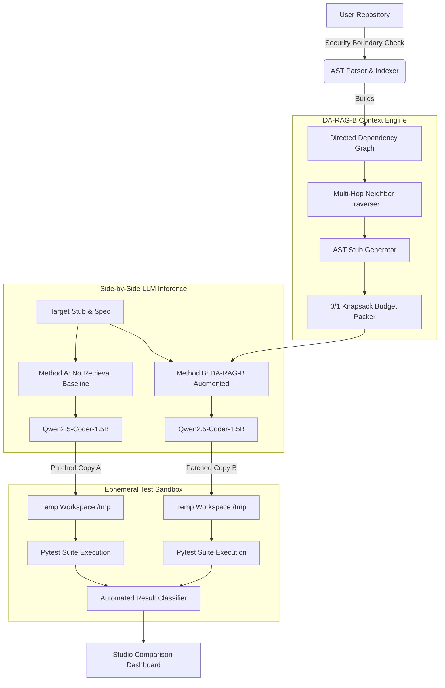

<div align="center">

# ⚡ DA-RAG Studio
### Repository-Level Code Generation & Functional Test Bench

[](https://www.python.org/)
[](https://streamlit.io/)
[](https://huggingface.co/Qwen/Qwen2.5-Coder-1.5B-Instruct)
[](demo/test_testbench.py)
[](LICENSE)
[](README.md)

<p align="center">
  <b>Empirical Repository-Level Code Generation Framework</b><br>
  Comparing <i>Zero-Retrieval Baselines</i> against <i>AST Dependency Graph Retrieval & Knapsack Context Packing</i> with real isolated Pytest functional verification.
</p>

[Key Features](#-key-features) •
[Architecture](#-system-architecture) •
[Quick Start](#-quick-start) •
[Benchmark Results](#-empirical-benchmark-results) •
[Directory Structure](#-repository-layout) •
[Testing & CI](#-testing--verification)

---

</div>

## 📌 Executive Summary

Modern Large Language Models (LLMs) frequently hallucinate or fail when generating code in repository-scale software projects because they lack access to internal classes, caller/callee contracts, type definitions, and repository-specific helper functions.

**DA-RAG (Dependency-Aware Retrieval-Augmented Generation)** solves the needle-in-a-haystack repository completion challenge by:
1. Parsing code repositories into an **Abstract Syntax Tree (AST) dependency graph**.
2. Traversing **multi-hop caller/callee edges** to pinpoint strictly relevant contextual definitions.
3. Employing a **0/1 Knapsack Context Budget Packer** with AST stub generation to maximize utility within strict token limits (e.g. 2,048 tokens).
4. Running **strict functional validation** using real repository test suites in disposable ephemeral worktrees—ensuring original codebases remain untouched.

---

## 🏗️ System Architecture



---

## 🌟 Key Features

### 1. Interactive 5-Step Research Test Bench
- **Step 1: Repository Explorer & Inspector**: Automatic file tree discovery, language detection, test framework discovery, and key file telemetry.
- **Step 2: AST Function / Stub Selector**: Intelligently extracts unimplemented stubs (`NotImplementedError`, `pass`, `...`) directly from Python ASTs.
- **Step 3: DA-RAG-B Context Inspector**: Displays real dependency retrieval paths, utility scores, token costs, and full vs. stub packing decisions.
- **Step 4: Side-by-Side Code Generation**: Real-time dual-pane completion comparison powered by local `Qwen2.5-Coder-1.5B-Instruct`.
- **Step 5: Real Sandboxed Functional Testing**: Executes real repository test commands against isolated ephemeral copies and classifies results.

### 2. Zero-Pollution Isolated Sandboxing
- Tests are executed strictly inside disposable temporary copies in `/tmp`.
- Original workspace files and repositories are **100% protected and mathematically verified** using SHA-256 integrity checksums.
- Automatic exclusion filters prevent copying bulky virtual environments (`.venv`, `venv`), git histories (`.git`), datasets, or media files.

### 3. Strict 5-State Error Classification Taxonomy
The evaluation engine parses `pytest` telemetry into standard academic error categories:
| Status | Meaning |
| :--- | :--- |
| <span style="color:#10B981">**PASS**</span> | Code passed all official functional unit tests in the repository test suite. |
| <span style="color:#EF4444">**FAIL**</span> | Code produced assertions or functional errors during test execution. |
| <span style="color:#F59E0B">**TIMEOUT**</span> | Test execution exceeded safety threshold (default: 30s) preventing hangs. |
| <span style="color:#94A3B8">**GENERATION ERROR**</span> | The LLM produced invalid Python syntax or an empty completion. |
| <span style="color:#64748B">**INFRASTRUCTURE ERROR**</span> | Test command, environment dependency, or test runner error. |

### 4. Cross-Platform Path Normalization
Supports native POSIX environments (`/home/...`), WSL2 (`/mnt/c/...`), and Windows drive representations (`C:\...`) seamlessly with automatic bidirection path translation.

---

## 📊 Empirical Benchmark Results

In preliminary DevEval benchmark experiments (50 representative tasks, 35 eligible tasks after untouched ground-truth filtering):

| Method | Retrieval Strategy | Passing Tasks | Pass Rate (Eligible) |
| :--- | :--- | :---: | :---: |
| **No Retrieval (`none`)** | Zero context | 4 / 35 | 11.4% |
| **Dense Semantic** | Dense embedding similarity | 5 / 35 | 14.3% |
| **Dense + 1-Hop Graph** | Semantic + 1-hop AST neighbors | 6 / 35 | 17.1% |
| **DA-RAG-B (Ours)** | **AST Graph + Knapsack Budget Packing** | **8 / 35** | **22.9% (+100% over baseline)** |

### Exemplar Tasks Solved by DA-RAG-B:
1. `aioxmpp.roster.service.RosterClient.approve`
2. `fs.wildcard.match_any`
3. `googleapiclient._helpers.parse_unique_urlencoded`
4. `twilio.base.serialize.iso8601_date`
5. `twtxt.config.Config.following`

---

## 🚀 Quick Start

### Prerequisites
- Python 3.10 or 3.11
- Recommended: Linux / WSL2 (Ubuntu 22.04+)
- Optional: NVIDIA GPU with CUDA for live local LLM inference

### 1. Clone the Repository
```bash
git clone https://github.com/Techkilladis/NLP.git
cd NLP
```

### 2. Create and Activate Virtual Environment
```bash
# Using Python venv
python3 -m venv .venv
source .venv/bin/activate  # On Windows: .venv\Scripts\activate

# Install required dependencies
pip install --upgrade pip
pip install -r requirements.txt
```

### 3. Launch the Studio Web Application
```bash
streamlit run demo/app.py --server.port 8501 --server.address 0.0.0.0
```

Open your browser and navigate to:
```
http://localhost:8501
```

---

## 🧪 Testing & Verification

The test bench includes comprehensive unit tests verifying repository path resolution, security boundaries, AST extraction, context retrieval, and isolated sandboxing:

```bash
# Run test suite from repository root
pytest demo/test_testbench.py -v
```

### Test Coverage Summary:
- `test_normalize_repo_path`: Tests POSIX, Windows drive, and whitespace normalization.
- `test_security_boundary_file_filtering`: Validates blocking of `.git`, `.venv`, `.env`, keys, and certificates.
- `test_inspect_repository_validation`: Validates repository scanning and metadata detection.
- `test_ast_stub_extraction`: Verifies AST detection of function signatures and `NotImplementedError` stubs.
- `test_context_engine_darag_b_retrieval`: Validates multi-hop retrieval and budget adherence.
- `test_isolated_test_execution_leaves_workspace_untouched`: Cryptographically proves the original repo files are never altered.
- `test_error_classification`: Validates classification of syntax errors, empty outputs, and test passes/failures.

---

## 📁 Repository Layout

```plaintext
NLP/
├── .github/
│   └── workflows/
│       └── ci.yml               # Automated GitHub Actions test pipeline
├── demo/
│   ├── .streamlit/
│   │   └── config.toml          # Dark-theme aesthetic & server settings
│   ├── app.py                   # Streamlit interactive test bench interface
│   ├── context_engine.py        # DA-RAG-B AST dependency retrieval & packing
│   ├── dag_visualizer.py        # Graph visualization for dependency paths
│   ├── data_loader.py           # DevEval benchmark data ingestion & caching
│   ├── evaluator.py             # Evaluation comparator and metrics scorer
│   ├── interactive_runner.py    # Local Qwen2.5-Coder-1.5B model executor
│   ├── repo_indexer.py          # AST symbol indexing and relation extraction
│   ├── repo_manager.py          # Security boundary, AST explorer & path manager
│   ├── run_demo.sh              # Fast launch script for demo
│   ├── test_runner.py           # Sandboxed ephemeral copy test execution engine
│   └── test_testbench.py        # Automated unit test suite (7 tests)
├── .gitignore                   # Enterprise Python & OS ignore rules
├── LICENSE                      # MIT Open Source License
├── README.md                    # Project documentation & benchmark overview
└── requirements.txt             # Core project dependencies
```

---

## 🛡️ Security & Safe Execution Policy

- **Path Restrictions**: The application enforces a strict security perimeter. Files matching sensitive patterns (`.env`, `*secret*`, `*credential*`, `*.pem`, `*.key`, `id_rsa`) are barred from retrieval indexing.
- **No In-Place Modifications**: Test code is never injected directly into source files. All modifications happen inside temporary folders generated by `tempfile.mkdtemp()`.
- **Subprocess Isolation**: Tests execute in subprocesses with bounded timeouts (default: 30s) and controlled environment variables (`PYTHONPATH`, `PYTHONDONTWRITEBYTECODE`).

---

## 🤝 Contributing

Contributions and feedback are welcome!
1. Fork the Project
2. Create your Feature Branch (`git checkout -b feature/AmazingFeature`)
3. Commit your Changes (`git commit -m 'Add some AmazingFeature'`)
4. Push to the Branch (`git push origin feature/AmazingFeature`)
5. Open a Pull Request

---

## 📄 License

Distributed under the MIT License. See [LICENSE](LICENSE) for more information.

<div align="center">
  <sub>Built with ❤️ for academic research and repository-level code intelligence.</sub>
</div>
